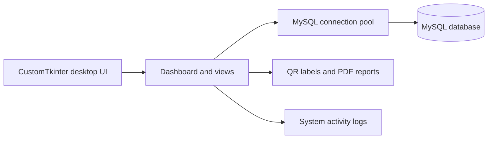

# Champion Management System

**Inventory and equipment accountability | Python desktop ERP prototype**

A CustomTkinter and MySQL application for managing equipment, consumables, projects and operational accountability. The existing interface and business workflows are retained.

## Modules

| Module | Purpose |
| --- | --- |
| Dashboard | Operational overview and notifications |
| Inventory and tagging | Stock records, QR identifiers and labels |
| Issuance and tracking | Equipment borrowing, returns and accountability |
| Projects | Project requirements and assigned resources |
| Maintenance | Equipment issues and maintenance workflows |
| Reports | Operational reports and inventory analysis |
| Role management | Employee accounts, permissions and password reset requests |
| Profile / help | Account and user guidance |

## Architecture



## Local development

Use a disposable MySQL database and fictional data only. Do not point this checkout at the organization's live database without authorization. The original dependency versions are retained in requirements.txt; their availability and the complete desktop runtime have not been verified.

```powershell
py -3.12 -m venv .venv
.\.venv\Scripts\python.exe -m pip install -r requirements.txt
Copy-Item .env.example .env
```

Create a local database and authorized MySQL user separately; edit .env with your own values. Remote connections now require a trusted CA file and hostname verification (DB_SSL_CA). Never reuse exposed credentials. On a fresh disposable database, run create_tables.py for the base tables. The legacy schema patches are retained for reference; the full schema, migrations and module compatibility need validation against a disposable server. Do not execute legacy repair/migration scripts indiscriminately. Run seed_admin.py to explicitly set a first administrator password; it refuses to reset existing accounts. Launch main.py.

```powershell
.\.venv\Scripts\python.exe -m unittest discover -s tests -v
.\.venv\Scripts\python.exe main.py
```

## Security and data handling

- Credentials are local environment configuration; example values are placeholders.
- Administrator setup has no default password or forced reset.
- Login checks active status and rejects malformed bcrypt hashes.
- QR badge filenames are sanitized.
- Local remembered usernames, profiles, database dumps and build artifacts are ignored.
- Existing credential exposure in Git history is **not** resolved by these changes. Rotate/revoke the exposed database credential, review access logs and arrange authorized history remediation before sharing this repository. Do not commit employee records or client data.
- This is a desktop client with shared database privileges, not a hardened multi-tenant service. The original audit log has a 10,000-entry retention cap; it is not an immutable audit trail.

See [security and setup notes](docs/security-review.md). Screenshots, team roles, business approval and acceptance test evidence need review before publication. No measured reliability or business outcome is claimed.
