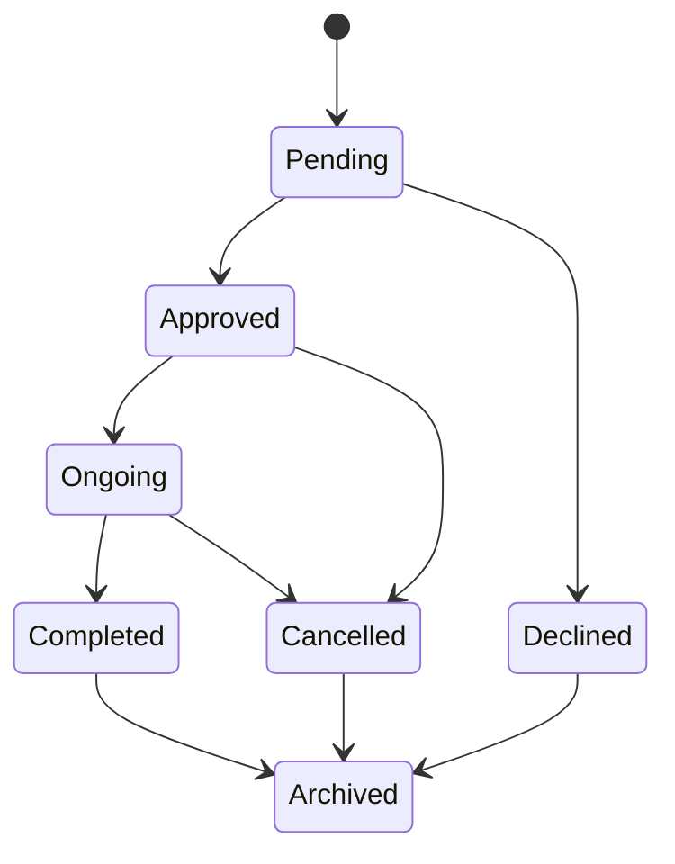

# Database (MySQL 8.0, InnoDB, utf8mb4)

The canonical schema is **`db/schema.sql`** (tables) + **`db/triggers.sql`** (rules). **`db/migrate.py`** brings any earlier
shape of the database to it. Nothing in the application creates or alters tables any more.

```
python -m db.migrate --status           # read-only: what is pending
python -m db.migrate --make-backup      # verified mysqldump first, then upgrade; re-runnable, no-op when current
python seed_admin.py                    # first Admin on an empty database
python -m db.apply_grants               # champion_staff / champion_admin accounts (needs STAFF_DB_PASS, ADMIN_DB_PASS)
```

Safety rules enforced in `db/migrate.py`: refuses without a fresh (default 60 min) `mysqldump` that has the
`-- Dump completed` trailer and names this database; refuses any `*.aivencloud.com` host; adds a constraint only if the
existing rows already satisfy it (otherwise records "skipped: N rows violate ..." in `schema_migrations.notes`).
The app checks the schema version at login and says "needs an upgrade" instead of running against a half-migrated database.

## Connections and transactions (`db/pool.py`)
* One lazily-created pool per process (lock-guarded), `DB_POOL_SIZE` (default 16), `DB_CONNECT_TIMEOUT`, `DB_POOL_WAIT`.
* Every checkout pings (reconnecting if the server dropped us) and re-applies session settings: time zone **+08:00**, STRICT
  `sql_mode`, autocommit **off**. The server clock is the only clock; the old `DATE_ADD(.., INTERVAL 8 HOUR)` hacks are gone.
* `with db.read() as cur:` / `with db.transaction() as cur:` always return the connection. `db.run_in_transaction(fn)` re-runs
  `fn` once on deadlock (1213) or lock-wait timeout (1205).
* `localhost` is mapped to `127.0.0.1`: on Windows the name costs ~2 s per connection and the pool opens all of them up front.
* If MySQL cannot be reached, `DatabaseOffline` is raised, listeners fire, and the dashboard shows a non-blocking
  "Database offline - retrying" banner. Dialogs use `db.user_message(exc)`, never driver text.

## Stock changes (`services/stock_ledger.py`)
Every issuance/retrieval/maintenance write follows: `lock_inventory` (SELECT ... ORDER BY tool_id **FOR UPDATE OF i**: fixed order,
so two terminals asking for tools in opposite orders cannot deadlock) -> re-validate from the locked rows -> `take_stock`
(`UPDATE ... WHERE quantity_available >= qty`, rowcount must be 1) -> insert history -> COMMIT. Proven by
`tests/test_stock_concurrency.py` (two threads, one last unit; 8 threads, 3 units; connection killed mid-transaction).

Per-unit condition (replaces "one damaged return blocks the whole tool"). `quantity_total` is the units the company still owns:
`quantity_available = quantity_total - deployed - quantity_in_maintenance`.
* **Damaged / Needs Repair** return: those units move to `quantity_in_maintenance`; the other units stay issuable.
* **Lost** return: the units leave `quantity_total` (exactly as the old screens did, so Inventory, Reports and the dashboard totals do not
  shift) and are added to `quantity_lost`, a running count for reports. (This differs from the brief's literal "available = total -
  deployed - in_maintenance - lost"; the same units are accounted for, just on the other side of `total`.)
* Repairing returns units to available (total unchanged: fixes the old double-count); writing off shrinks the total.
* `tool.condition` is now only a **display flag** derived from OPEN tickets (worst wins, else Good). It no longer blocks issuing, and a later
  Good return can no longer hide a damaged unit.
* Equipment is one `transaction` row per unit (`quantity = 1`) so condition is per unit; a consumable is ONE row with its exact quantity (a
  partial return splits the row). Always use `SUM(quantity)`, not `COUNT(*)`.

**Isolation level.** `db.transaction()` defaults to `READ COMMITTED`. Our writes are "lock the rows, re-check, change". Under MySQL's
default `REPEATABLE READ`, a plain `SELECT` inside the transaction (for example the deployed-quantity check) reads the snapshot taken when
the transaction's first plain read *started*, which can be before it finished waiting for another terminal's lock, so it misses that
terminal's committed rows. `tests/test_issuance_service.py::test_two_terminals_cannot_together_exceed_the_project_quota` caught exactly
this (two terminals each issuing 2 against a quota of 3 both succeeded) before the default was changed.

## Tool cache (`services/tool_cache.py`)
`tag_id -> ToolRecord` and `tool_id -> ToolRecord` in memory for O(1) scans. **Display and lookup only, never the source of
truth**: stock and condition are re-read under `FOR UPDATE` at commit. Cross-terminal sync: `tool.updated_at` /
`inventory.updated_at` are `TIMESTAMP(3) ... ON UPDATE CURRENT_TIMESTAMP(3)`; a daemon thread polls every ~4 s for newer rows,
re-reads a 3 s overlap window (a transaction is stamped when its statement runs but visible when it commits) and does a full
reload every 60 s.

## The four dates
| Date | Where | Source | Rule |
|---|---|---|---|
| Project start | `transaction.project_start_date` | copied from the project at issuance (snapshot) | immutable |
| Project end / due | `transaction.due_date` | copied from the project at issuance (snapshot) | immutable; **issuance date must not be after it** (trigger `trg_txn_bi`) |
| Issuance | `transaction.borrow_date` | server `NOW()` | cannot be changed |
| Retrieval | `transaction.return_date` | server `NOW()` | `>= borrow_date` (trigger + CHECK) |

`projects`: `start_date <= end_date` (CHECK). **Issuance before the start date is allowed** ("staged early"); a literal
`Issuance <= Start` rule would block every top-up issuance after a project has started.

## Project status (`project_transitions`, trigger `trg_projects_bu`)

`Archived` is not a status: it is `projects.archived_at` on a Completed/Declined/Cancelled project. The trigger remembers
`status_before_archive` and restoring puts the project back to exactly that status (the old screen always set `Approved`).
`project_service` owns every project write, so the two edges the old screens needed (`Pending->Cancelled` as "declined", `Approved->Pending` as a Staff edit) are gone; "Declined" is now a real status.
Once a project is Ongoing/Completed, or any tool was ever issued to it: dates and workers are read-only (trigger), requirements
cannot be inserted/changed/deleted (marking a line `Fulfilled` is still allowed).

## Triggers (`db/triggers.sql`)
`trg_projects_bu` (state machine, archive/restore, schedule lock) - `trg_projects_workers_ai/au` (keep `project_workers` in step
with the legacy text, exact employee-id match) - `trg_req_bi/bu/bd` (requirements lock) - `trg_txn_bi/bu` (four dates) -
`trg_issue_bu` (keeps `is_resolved` and `status` consistent). Errors carry the prefix `CHAMPION:`.

## Accounts (`db/grants.sql`, `db/apply_grants.py`)
Each terminal's `.env` carries **one** account: Staff terminals `champion_staff`, the Admin workstation `champion_admin`.
**Staff**: SELECT on the screens' tables (not `system_logs`); INSERT/UPDATE `transaction`; UPDATE only
`inventory(quantity_available, quantity_in_maintenance, quantity_lost)`, `tool(condition, tag_id)`, `projects(status)`,
`project_requirements(status)`, `user(full_name, email, password_hash, failed_attempts, reset_requested, status)`; INSERT
`tool_issues`, `help_tickets`, `system_logs`. No DELETE, no DDL, cannot change `role`. **Admin**: everything inside the application
database only. Verified by `tests/test_grants.py`.
> Staff has no SELECT on `system_logs`: any Staff screen that reads it (e.g. the dashboard activity feed) must read through a service
> in Phase 2.

## Entity-relationship diagram
Generated from a freshly migrated database (`information_schema`), so it cannot drift from the schema. `schema_migrations` and
`schema_meta` (bookkeeping) are omitted.

```mermaid
erDiagram
    backup_logs {
        int backup_id PK
        varchar(255) filename
        text filepath
        varchar(50) file_size
        text note
        int created_by
        timestamp created_at
        varchar(50) status
        varchar(20) type
        char(64) sha256
    }
    help_faqs {
        int id PK
        varchar(255) question
        text answer
        tinyint(1) is_admin_only
        int display_order
    }
    help_guides {
        int id PK
        varchar(255) title
        text steps
        tinyint(1) is_admin_only
        int display_order
    }
    help_tickets {
        int ticket_id PK
        int user_id
        varchar(255) subject
        text message
        text admin_reply
        varchar(50) status
        timestamp created_at
    }
    id_sequences {
        varchar(10) prefix PK
        smallint yr PK
        int last_seq
    }
    inventory {
        int inventory_id PK
        int tool_id FK UK
        decimal(10.2) quantity_total
        decimal(10.2) quantity_available
        decimal(10.2) minimum_stock
        decimal(10.2) quantity_in_maintenance
        decimal(10.2) quantity_lost
        timestamp(3) updated_at
    }
    project_requirements {
        int req_id PK
        int project_id FK
        int tool_id FK
        decimal(10.2) quantity
        varchar(20) status
    }
    project_transitions {
        varchar(50) from_status PK
        varchar(50) to_status PK
        tinyint(1) legacy
    }
    project_workers {
        int project_id PK FK
        int user_id PK FK
        timestamp assigned_at
    }
    projects {
        int project_id PK
        varchar(255) name
        varchar(255) client
        varchar(255) location
        varchar(255) project_head
        date start_date
        date end_date
        text description
        text workers_assigned
        text tools_needed
        int approved_by
        int manager_id
        varchar(50) status
        tinyint(1) is_archived
        timestamp archived_at
        varchar(50) status_before_archive
    }
    system_logs {
        int log_id PK
        int user_id
        varchar(100) action_type
        varchar(100) module
        text details
        timestamp timestamp
    }
    system_requirements {
        int id PK
        varchar(50) req_type
        varchar(255) component
        text specification
        int display_order
    }
    tool {
        int tool_id PK
        varchar(100) name
        text description
        varchar(100) category
        varchar(100) supplier
        varchar(100) location
        varchar(50) item_type
        varchar(20) unit_of_measure
        varchar(50) condition
        varchar(100) tag_id UK
        tinyint(1) is_archived
        datetime archived_at
        datetime date_acquired
        decimal(10.2) price
        timestamp(3) updated_at
    }
    tool_issues {
        int issue_id PK
        int tool_id FK
        int transaction_id FK
        varchar(100) reported_by
        int reported_by_user_id
        varchar(100) condition_flag
        text notes
        decimal(10.2) quantity
        timestamp flagged_at
        tinyint(1) is_resolved
        varchar(20) status
        int resolved_by
        datetime resolved_at
    }
    transaction {
        int transaction_id PK
        int tool_id FK
        int user_id FK
        int project_id FK
        varchar(50) type
        varchar(255) purpose
        decimal(10.2) quantity
        datetime borrow_date
        datetime return_date
        date project_start_date
        date due_date
        varchar(50) status
        varchar(100) condition_at_borrow
        varchar(100) condition_at_return
        text condition_return_notes
        int issued_by
        int received_by
    }
    user {
        int user_id PK
        varchar(50) employee_id UK
        varchar(100) full_name
        varchar(100) email UK
        varchar(50) role
        varchar(255) password_hash
        varchar(50) status
        int failed_attempts
        tinyint(1) reset_requested
        datetime archived_at
    }
    tool ||--o{ inventory : "tool_id (CASCADE)"
    projects ||--o{ project_requirements : "project_id (CASCADE)"
    tool ||--o{ project_requirements : "tool_id (RESTRICT)"
    projects ||--o{ project_workers : "project_id (CASCADE)"
    user ||--o{ project_workers : "user_id (RESTRICT)"
    tool ||--o{ tool_issues : "tool_id (RESTRICT)"
    transaction ||--o{ tool_issues : "transaction_id (SET NULL)"
    projects ||--o{ transaction : "project_id (SET NULL)"
    tool ||--o{ transaction : "tool_id (RESTRICT)"
    user ||--o{ transaction : "user_id (RESTRICT)"
```

## Compatibility columns (removed once no screen reads them)
`projects.workers_assigned` (text; `project_workers` is the source of truth), `projects.is_archived` (kept in sync by trigger;
`archived_at` is canonical), `tool_issues.is_resolved` (kept in sync with `status`), `tool_issues.reported_by` (free text; use
`reported_by_user_id`).

## Importing data from the old cloud database
The Aiven server stored `DATETIME`/`TIMESTAMP` values in **UTC** and the old screens added 8 hours on display. This system now
stores Manila time (+08:00). When moving old rows into the local server, shift every `borrow_date`, `return_date`,
`system_logs.timestamp`, `tool_issues.flagged_at`, `backup_logs.created_at`, `help_tickets.created_at` by **+8 hours** once, or
history will read 8 hours early.
